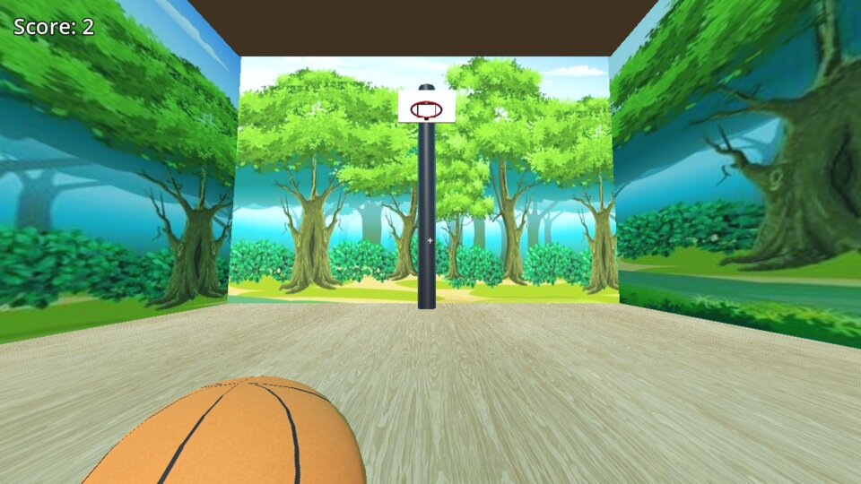

# BasketBall — my first Godot game

A small first-person basketball game made in **Godot 4.4** with GDScript. Walk around an indoor court, pick up the ball, and throw it through one of the two hoops to score.

This was my first game and my first project on GitHub.



## Controls

| Key | Action |
| --- | --- |
| W A S D | Move |
| Mouse | Look around |
| Space | Jump |
| E | Pick up / drop the ball |
| Q | Throw the ball |
| Esc | Pause menu (resume, restart, back to menu) |

## Features

- First-person movement with mouse look and jumping
- Physics-based ball you can carry, drop and throw
- Two hoops that count a basket when the ball drops through the rim
- Score counter, main menu, pause menu and an options screen with a music volume slider
- Looping background music on its own audio bus

## Running it

1. Install [Godot 4.4](https://godotengine.org/download) or newer (the standard build, not .NET).
2. Clone this repository.
3. In the Godot Project Manager, choose **Import** and select `project.godot`.
4. Press **F5** to play.

## Project structure

```
scenes/    menu, options, pause menu, the court and a reusable hoop scene
scripts/   player controller, score keeping (autoload), hoop scoring, UI
textures/  floor, wall and ball textures
audio/     background music
addons/    GDQuest's Gobot model used for the player body
```

`GameManager` is an autoload that stores the score and emits a `score_changed` signal. The score label listens to that signal, and each hoop's `ScoreArea` calls `GameManager.add_score()` when the ball passes through moving downward.

## Credits

- Player movement and object-holding code is adapted from the *Godot4.3 Simple FPS Controller* by CiaNCI Studio (MIT; notice kept in [LICENSE](LICENSE)).
- **Gobot** 3D model by [GDQuest](https://github.com/gdquest-demos/godot-4-3D-Characters), licensed CC BY-NC-SA 4.0 (see `addons/gdquest_gobot/LICENSE.md`).
- Floor texture: *Oak Veneer 01* from [Poly Haven](https://polyhaven.com/) (CC0).
- Music: *Night Shade* by AdhesiveWombat.
- Basketball texture, hoops and court layout made for this project.

## License

Code is released under the [MIT License](LICENSE). Third-party assets keep their own licenses listed above.
